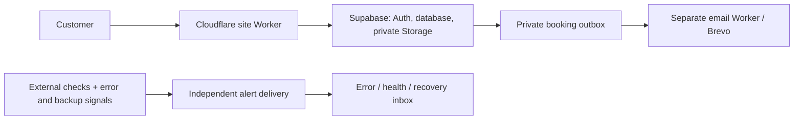

# F-027: Service setup and alert routing

**Status:** Needs answers (not approved for implementation) · **Milestone:** M3 · **Coordinates with:** F-014, F-016 and F-026 setup preflight · **Final integration:** reviewed F-020–F-026 release revision. Setup preparation precedes F-014/F-016 final release acceptance; it does not depend on those release checks already being complete.

## Goal and confirmed decisions

Prepare Supabase, Cloudflare and Brevo ownership, environment settings and notification routing so the owner can approve a concrete, tested release. This document authorizes no account changes, provisioning, email sends, deployment or hosted migrations.

- Owner confirmed on 2026-11-26: service accounts use `hercowebsite@gmail.com`; booking/admin operational notices go to `browf1st10@gmail.com`; errors, health and recovery alerts go to `elijahpayoc12@gmail.com`.
- These are account-login and recipient choices. They do not establish a verified email sender or domain, an app staff identity, or Git credentials.
- Existing F-014 owns customer email templates, delivery and reminders. F-016 owns production release evidence, analytics and release approval; no standing staging environment is required. F-027 coordinates setup and any approved routing extension; it does not silently approve their outstanding decisions.
- Future implementation starts F-020 and follows dependency order through F-026. Inspect the actual checkout and existing work first; do not restore old implementation wholesale. This spec does not declare those features implemented.
- F-027's unanswered setup decisions do not block starting already Ready F-020 work. Session handoff must preserve uncommitted work and inspect saved implementation for selective reuse; reuse can reduce repeated work but still requires review and full verification. Usage allowance is shared across sessions: opening a chat does not reset it, and this spec makes no exact token-budget claim.

## Routing

| Message | Recipient / owner | Required behavior |
| --- | --- | --- |
| Provider account ownership | `hercowebsite@gmail.com` | Confirm actual access, recovery and billing ownership separately for each service. |
| Customer signup, verification, password recovery | The requesting customer's address | Supabase Auth + configured SMTP; never forward OTPs, reset links or passwords to admin inboxes. |
| Booking receipt, confirmation, change decision and approved reminders | Booking customer's address | Existing F-014/F-017 rules; keep customer mail separate from staff notices. |
| Staff booking/admin notices | `browf1st10@gmail.com` | Existing change-request inbox plus only the additional events explicitly approved below. No private evidence, credentials or customer authentication content. |
| Application errors, availability, stale backups, failed recovery jobs and recovery notices | `elijahpayoc12@gmail.com` | Operational alert route, separate from booking outbox; verify incident and recovery delivery. |
| Provider security/billing mail | Provider-supported account contacts | Inspect supported settings; account ownership does not guarantee every provider notice can use the operational inbox. Record any limitation. |

Owner requested booking/admin notifications broadly. Current implementation only documents staff cancellation/reschedule request notices. Confirm whether this expands to new booking, approval, completion, cancellation, reschedule, price/service edits and failed delivery, and whether walk-ins are included. Do not invent templates or duplicate customer mail to achieve this.

## Existing resources and safe setup

- Inventory existing project IDs, Worker names, regions, account owners, domains, billing plans, migration history and active integrations in a private setup record. Do not copy keys or customer data into this spec.
- Decide whether to retain resources with correct access or transfer supported ownership. Supabase supports project transfers subject to prerequisites; transfer is not permission to delete/recreate a database. Evaluate Cloudflare/Brevo account changes separately before proposing commands.
- Owner uses one production application environment. Use local fictional checks and disposable isolated recovery verification; do not provision a standing staging project/Worker. Production-only hosted writes and sends need their action-specific authorization.
- Preflight the exact release revision and full ordered migration chain, including `202611250002_staff_guest_booking.sql` and its recorded-name RPC, following F-026's unchecked setup reminder. A partially installed migration or mismatch stops release. Installation, schema-cache refresh and migration bookkeeping are separate checks.
- Verify backups and a restore drill before any separately authorized hosted migration. Never rerun a non-idempotent migration just to refresh schema cache; never overwrite historical bookings, prices or service snapshots.
- Public approved powder swatches must remain isolated from private completion evidence. Check bucket privacy, policies, signed evidence access and allowed file types; never make evidence public to repair an image problem.
- Keep normal staff access based on verified account, enabled membership and current grants. Service account ownership does not grant application staff permissions. Preserve the existing approved password-based staff policy.

## Sender and delivery requirements

- Production `EMAIL_FROM` needs an owner-chosen sender on a controlled, Brevo-authenticated domain. Gmail domains cannot be authenticated in Brevo. A Gmail login or notification recipient does not establish an acceptable production From address.
- Confirm Reply-To separately; approve sender display name and F-014 wording before release. Supabase Auth SMTP sender and booking-worker sender must each be checked.
- Retain transactional outbox isolation, five-message batches and existing claim/lease behavior. Explicit rate limits back off (maximum 24 hours/five attempts); permanent rejection stops; ambiguous timeout/crash goes to review. Reconcile provider logs before requeueing to avoid duplicates. Booking success must not depend on email success.
- Leave `HERCO_EMAIL_MODE=disabled` until explicit send authorization. Approved controlled delivery checks use allowlist with explicit recipients in the single production environment; live mode requires separate release approval. Existing historical local sends do not authorize new sends.
- Recheck recipient, event state and reminder schedule before delivery. Do not redirect customer messages to staff. Approve how an inbox change affects queued staff events; default proposal follows existing skip-on-changed-inbox behavior.

## Monitoring proposal (decisions pending)

- Check homepage availability, a small API response and an authenticated or narrowly scoped read-only database readiness probe. Current `/api/health` checks configuration presence only; it cannot prove database readiness. Any new probe/API must be designed in `docs/api-contract.md` before code, expose minimal status and have no booking writes or private records.
- Collect bounded, redacted error signals from site/email/cleanup workers and backup runner. Do not log auth tokens, cookies, addresses, request bodies, customer instructions, evidence URLs or provider secrets. Limit stack access and retention.
- Configure actual alert delivery plus an external check; logs alone do not notify anyone. The alert path must still work if Brevo or the booking email Worker fails. An external provider must not depend solely on the monitored site being alive.
- Proposed incident policy: group repeated errors by environment/component/cause; alert after an approved failure threshold, deduplicate while open, send recovery only after sustained success. Define timeout, interval, repeat ceiling and maintenance suppression before implementation.
- Watch email backlog/failures, backup age, cleanup failures and restore-drill failures as operational signals. Recovery notices must describe observed restoration, never claim data recovered from an HTTP success alone.
- Keep check frequency, logs, retries and alert volume within an approved budget. No paid provider, domain purchase or plan upgrade is selected by this draft.

## Options to decide

| Option | Tradeoff | Recommendation |
| --- | --- | --- |
| Existing service plans + a free external monitor tier with independent email delivery | No new subscription if the chosen tier supports the checks; intervals, retention and notification limits must be verified before selection. | Evaluate first; insufficient coverage must remain a release blocker. |
| Existing services + a paid external monitor/alert plan | May provide faster checks and better incident controls; adds a new account, recurring cost and data processor. | Choose only if free coverage cannot meet approved requirements. |
| Existing services + an independently hosted scheduled checker | More control but more credentials, maintenance and a new failure point; hosting may cost money. | Avoid unless the owner prefers maintaining it. |

No monitor provider or current paid price is approved. Before selection, compare official pricing, limits and delivery dependencies against the owner's budget and record the checked date. Do not infer unlimited free capacity.

## Owner setup checklist (execute only after the relevant approval)

1. Sign in to each provider directly as the approved service owner. Open account/organization settings and confirm access and recovery details. Record resource identifiers privately; do not paste recovery codes or secrets into chat.
2. Supabase Dashboard → intended project → project settings/API keys: copy the project URL and publishable key to the appropriate ignored `.env.local` or `.dev.vars`. Put restricted server keys only in their intended Worker secret stores; never in public bindings. Confirm exact dashboard labels at execution.
3. Brevo → Settings → Senders, Domains, IPs → Domains: add the approved controlled domain; copy Brevo's DNS records to the domain provider after authorization, then verify authentication. Configure the approved sender and separate SMTP/API credentials in Supabase SMTP and email Worker secrets.
4. Cloudflare Dashboard → Workers & Pages → intended Worker → Settings → Variables and Secrets: enter that environment's bindings. Use separate site/email/cleanup configuration and `.dev.vars.email` only for ignored local email settings. Never copy all secrets into every Worker.
5. Configure the approved staff inbox through the existing private database setting after separate hosted-change authorization. Configure the selected monitoring provider's recipients and independent delivery route after provider approval.
6. Approve the exact recipient allowlist, events and controlled production send window. Run local fictional end-to-end checks first, record redacted authorized outcomes, then request production release approval. Supply real values only through ignored files or provider secret stores; placeholders here are not runnable setup.

## Acceptance checks before completion

- [ ] Correct service owner and recoverable access verified; resource retention/transfer and billing choices recorded without data loss.
- [ ] Local fictional checks cannot write production records; separately approved controlled production sends stay inside their explicit recipient allowlist; disabled mode sends nothing.
- [ ] Customer Auth tokens/receipts reach only the intended customer; approved staff events reach only the operational inbox; health/error/recovery alerts reach only the alert inbox.
- [ ] Authorized staff access works; unsigned, wrong-user and revoked-grant requests are denied. Private evidence remains private; approved public swatches render.
- [ ] Fictional receipt, decision and approved reminder tests cover cancelled/moved bookings, changed inbox, duplicate events, invalid recipient and provider rejection.
- [ ] Brevo outage leaves bookings intact, bounds retries and triggers the independent alert; interrupted sends enter review without blind resends.
- [ ] Home/API/database failures and missing configuration are distinguishable; repeated failures deduplicate, maintenance suppresses approved noise, and sustained recovery sends one notice.
- [ ] Readiness probes are read-only and bounded; logs and alerts contain no secrets or private records; expired monitoring credentials fail visibly.
- [ ] Backup freshness failure and isolated restore drill verified; exact migration state, including `202611250002`, recorded before separately authorized application.
- [ ] Cost/volume ceilings and escalation owner recorded; alert storms and monitor/provider failures tested without paid upgrades or uncontrolled sends.
- [ ] QA and misuse review completed; `npm run check`, full `npm test`, applicable builds and relevant database/security checks pass for any later implementation. Record limitations rather than marking unrun checks passed.

## Open decisions (ask in small rounds)

1. Which controlled domain and production From address should be used, and what Reply-To/display name? If none, approve choosing/buying a domain separately; Gmail is not an authenticatable production domain.
2. Keep existing resources and grant/transfer ownership where supported, or prepare separate replacement environments with a reviewed data-preservation plan? No deletion/recreation is implied.
3. Which additional staff booking/admin events (including walk-ins) are required beyond current change-request notices?
4. What monthly budget and monitoring option/provider, check interval, failure/recovery threshold, repeat ceiling, retention and escalation owner are acceptable?

## Cross-feature release reminders — 2026-11-27

- Own production wiring of private evidence storage, approved API-abuse controls, backup/restore checks and independent error/health/recovery delivery to elijahpayoc12@gmail.com. Customer booking/Auth mail still goes only to its intended recipient; public swatches remain separate. Do not activate destructive cleanup, paid controls or live sends merely because a spec is written.
- Shared requirement: finished-product proof can be saved while Booked before Complete and viewed only by authorized staff/Admin/Owner (F-009/F-012/F-026); no customer proof access. API/data design must reconcile the existing optional customer photo-sharing path.
- Before release, verify request-abuse controls, protected Admin/Owner/data access and performance (F-016), database plus linked-photo backups/recovery (F-015), independent incident email to **elijahpayoc12@gmail.com** (F-027), and preserved historical transaction prices (F-004/F-021). Each feature verifies its affected paths; provider wiring belongs to the coordinating specs rather than seven duplicate implementations.
- One production application environment. Local fictional verification and disposable isolated recovery checks do not imply standing staging resources. These reminders record requirements, not completed security/performance audits or deployed protection.
- Open release decisions remain visible: proof retention and post-save edit/delete policy; evidence grant/API design; numeric API quotas/provider/budget; backup schedule/retention/destination/recovery targets; monitoring thresholds/provider. Previously Ready feature scope is not silently declared fully designed for these new extensions.

## Ready checklist

- [ ] Scope and every open decision settled.
- [ ] Routing, sender/domain, resource ownership strategy and budget approved.
- [ ] Monitoring provider, delivery independence, thresholds and any API/data changes designed.
- [ ] F-014 template decisions and F-016 release dependencies reconciled.
- [ ] Acceptance checks agreed; no unresolved questions.
- [ ] **Owner approved:** pending. Hosted changes, purchases, sends and production release still need their separate action-time authorization.

## Official references checked 2026-11-26

- [Brevo domain authentication](https://help.brevo.com/hc/en-us/articles/12163873383186-Authenticate-your-domain-with-Brevo-Brevo-code-DKIM-DMARC): controlled-domain requirement and setup path.
- [Supabase project transfer](https://supabase.com/docs/guides/platform/project-transfer): supported transfer process and prerequisites; verify before ownership changes.
- [Cloudflare Worker errors](https://developers.cloudflare.com/workers/observability/errors/): runtime failure signals; does not by itself configure external alert delivery.
